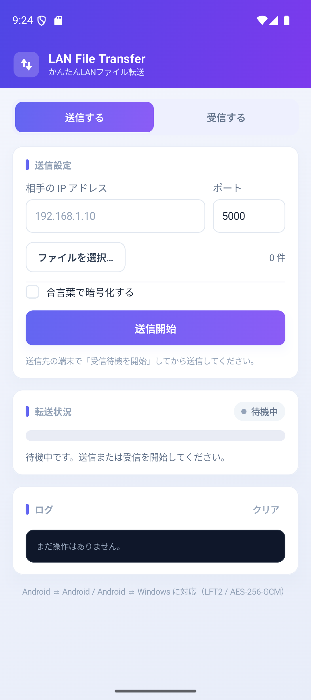
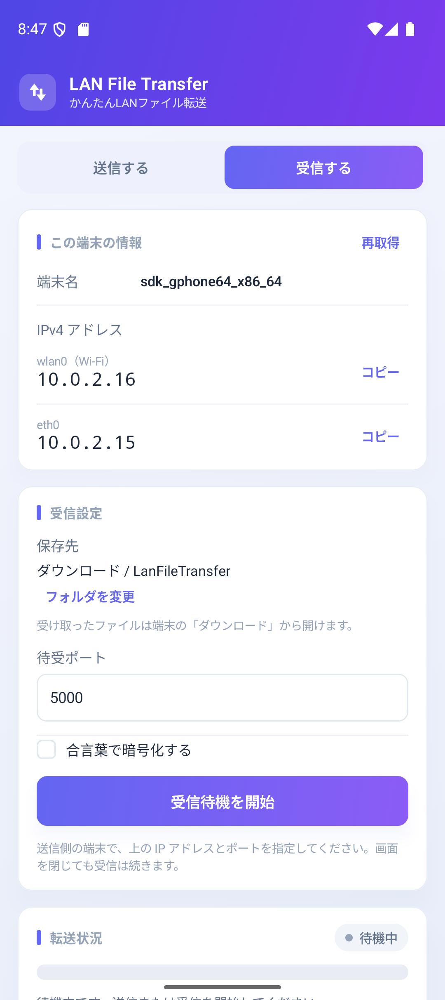

# Lan File Transfer For Android (ローカルネットワーク内でファイル送受信)

[](https://opensource.org/licenses/MIT)


同じ Wi-Fi / LAN 内の、Android 端末かWindowsPCとファイルをかんたんに送受信できるアプリです。

同じ独自プロトコル(LFT2)を使っている[Windows 版](https://github.com/OtabiHirohito/LanFileTransfer) とも
相互接続でき、**Android ⇄ Android / Android ⇄ Windows** で送受信できます。

<p align="center">
  
  
</p>

以下のようなシチュエーションを想定しています。
- クラウドなど外部サーバーを経由したくないファイルの送信
- USBが使えないPCからファイルを取り出す
- USB接続出来ないAndroidからファイルを取り出す
- 大容量ファイルの送受信


## 特長

- **アプリ同士で送受信** — 送信側で選んだファイルを、受信側へ順番に送信
- **合言葉による暗号化** — AES-256-GCM で通信を暗号化し、改ざんも検出
- **完全性検証** — 送受信したファイルの SHA-256 を照合
- **LAN 内で完結** — インターネット上のサーバーを経由しません
- **Windows版** — Android ⇄ Windowsで送受信できる [Windows 版](https://github.com/OtabiHirohito/LanFileTransfer) を用意

## 動作要件

| 項目 | 内容 |
| --- | --- |
| OS | Android 8.0 (API 26) 以上 |
| ネットワーク | 送受信する端末と同じ Wi-Fi / LAN(AP 分離・ゲスト Wi-Fi では通信できません) |
| ビルド | JDK 17 以上、Android SDK Platform 36(36.1)、Android Studio 推奨 |

## 使い方

### Android 同士で送受信する

1. **受信側**:「受信する」を選び、保存先・待受ポート(既定: `5000`)を確認します。
   必要なら **「合言葉で暗号化する」** を ON にして合言葉を入力します。
2. 受信側で **「受信待機を開始」** をタップします(初回は通知の許可を求められます)。
3. 受信側の画面に表示される **この端末の IPv4**(例: `192.168.1.23`)を、送信側の端末に入力します。
4. **送信側**:「送信する」を選び、相手の IP アドレス・ポート・合言葉を入力します。
5. **「ファイルを選択…」** で送信するファイルを選び、**「送信開始」** をタップします。

受信待機中は通知に **「受信待機中」** と表示され、画面を閉じても受信を続けます。
停止するときはアプリの **「受信待機を停止」** か、通知の **「停止」** を押します。

選択した順に 1 ファイルずつ送信します。送信中に **「送信停止」** を押すと中断できます。  
受信側がまだ **「受信待機を開始」** していない場合は、最大 60 秒間 接続を再試行します。
その間に受信側で待機を開始すれば、自動的に送信が始まります。

### Windows 版と送受信する

Windows 版と接続する場合も、上の手順と同じです。
Windows 側で「送信側になる」/「受信側になる」を選び、Android 側と同じ IP・ポート・合言葉を指定してください。
Windows ファイアウォールで、使用するポート(既定: `5000`)の受信を許可してください。

### 保存先について

Android 10 以降は MediaStore 経由で「ダウンロード」に保存するため、ストレージ権限は不要です。
Android 9 以前は、初回の受信開始時に書き込み権限を求めます(許可しない場合はアプリ専用フォルダ)。

同名のファイルがある場合は `名前(1).拡張子` のように連番を付けます。
受信に失敗したファイルは自動的に削除されます(不完全なファイルを残しません)。

### 通知とバッテリー

- 転送中は常駐通知に進捗が表示されます(Android 13 以上は通知の許可が必要)。
- 端末の電池最適化が強い場合、長時間の待受が止まることがあります。
  端末設定で本アプリを **「最適化の対象外」** にすると安定します。
- Android 15 以降、`dataSync` タイプのフォアグラウンドサービスには
  24 時間あたりの実行時間制限(6 時間)があります。終了したら再度開始してください。


## 通信仕様(LFT2)

Windows 版と共通のワイヤ形式です。Android 同士でもこの形式で通信します。

```text
[ハンドシェイク]
  送信→受信: 4byte マジック 'LFT2' (0x4C465432, リトルエンディアン)
             + 1byte フラグ(bit0=暗号化)
             + 16byte ソルト(暗号化時のみ)
  受信→送信: 1byte ステータス(0=OK, 1=拒否)
             拒否時: 2byte 理由長(LE) + 理由(UTF-8)
             OK かつ暗号化時: 32byte 鍵確認値
[4byte ファイル名長 (Int32 LE)][ファイル名 UTF-8]
[8byte ファイルサイズ (Int64 LE)][本体データ][32byte SHA-256]
```

| 項目 | 値 |
| --- | --- |
| 鍵導出 | PBKDF2-HMAC-SHA256(合言葉, ソルト, 100,000 回, 32byte) |
| 暗号化 | AES-256-GCM(レコード単位) |
| nonce | 12byte の末尾 8byte にビッグエンディアンの連番(読み書き別カウンタ) |
| 暗号化レコード | `[4byte 平文長 LE][暗号文][16byte 認証タグ]`(最大 128KiB) |
| 鍵確認値 | `HMAC-SHA256(鍵, 21byte のハンドシェイク)` |
| 接続 | 1 接続 = 1 ファイル、既定ポート 5000 |
| タイムアウト | ハンドシェイク 30 秒 / 無通信 60 秒 |
| 上限 | ファイル 100GiB / ファイル名 4096byte |
| ファイル名 | Windows / Android の両方で安全な名前に変換 (`..`、パス区切り、予約名などを除去) |

> `.NET` の `BitConverter` はリトルエンディアンです。Android 側もすべて LE で読み書きしています。

## セキュリティ

- 合言葉を設定すると、ハンドシェイク以降の通信は **AES-256-GCM** で暗号化され、改ざんも検出されます。
- 合言葉は端末に保存しません(起動のたびに入力)。設定画面にも残りません。
- 合言葉を設定しない場合は平文です。信頼できる LAN 以外では合言葉を設定してください。
- 受信側は、マジック値・ファイル名長・ファイルサイズを検証し、
  ハッシュ不一致や途中失敗のファイルを削除します。
- 合言葉による暗号化は接続ごとの簡易方式で、PKI による厳密な相手認証ではありません。
- 同一 LAN の信頼できるネットワークでの利用を想定しています。

## トラブルシューティング

### 接続できない(受信側の端末へ)

- 送信側と受信側の端末が **同じ Wi-Fi / LAN** にいるか確認してください。
- **ゲスト Wi-Fi** や **AP アイソレーション**(端末間通信の遮断)が有効だと接続できません。
- 受信側が表示する IPv4 が、送信側から到達できるアドレスか確認してください
  (Wi-Fi とモバイル回線の両方が有効な場合、表示が複数になることがあります)。
- 受信側が **「受信待機中」** になっているか確認してください。
  送信側は受信待機が始まるまで最大 60 秒待ちます。60 秒を過ぎると接続エラーになります。
- VPN が有効だと LAN 内の通信が遮断される場合があります。

### 接続できない(送信先が Windows の場合)

- Windows 側が **「受信待機を開始」** になっているか確認してください。
- Windows ファイアウォールで、使用するポート(既定: `5000`)の受信を許可してください。
- IP アドレス・ポート番号が合っているか確認してください。

### 「合言葉が一致しません」と表示される

- 両方で **「合言葉で暗号化する」** が ON か確認してください。
- 合言葉が完全に同じか確認してください(大文字・小文字、全角・半角、前後の空白)。
- 片方だけ古いバージョンでないか確認してください。

### 通知が表示されない / バックグラウンドで止まる

- Android 13 以上では通知の許可が必要です(設定 → アプリ → 通知)。
- 端末の電池最適化で停止する場合は、本アプリを最適化の対象外にしてください。
- メーカー独自の省電力機能(アプリの自動終了など)が働いていないか確認してください。

### 保存できない

- 既定の保存先は **「ダウンロード / LanFileTransfer」** です。Files アプリやダウンロード一覧から確認してください。
- Android 9 以前で書き込み権限を許可しなかった場合は、アプリ専用フォルダに保存されます。
  **「フォルダを変更」** で Downloads などを見える場所に選び直してください。
- 保存先の空き容量を確認してください。

### ポートが使用中になる

別のアプリが同じポートを使っています。待受ポートを `5001` などに変更してください。

## ビルドとインストール

### Android Studio で開く

`android` フォルダを Android Studio で開き、そのまま実行します。
`local.properties` は Android Studio が自動生成します。

### コマンドライン

```powershell
# Windows
cd android
.\gradlew.bat :app:assembleDebug
adb install -r app\build\outputs\apk\debug\app-debug.apk
```

```bash
# macOS / Linux
cd android
./gradlew :app:assembleDebug
adb install -r app/build/outputs/apk/debug/app-debug.apk
```

`local.properties` が無い場合は、SDK の場所を書いてください。

```properties
sdk.dir=C\:\\Users\\<user>\\AppData\\Local\\Android\\Sdk
```

### リリース

最新版は [GitHub Releases](https://github.com/OtabiHirohito/LanFileTransferForAndroid/releases) から
`app-release.apk` をダウンロードしてください。


## プロジェクト構成

```text
android/
├─ settings.gradle.kts / build.gradle.kts
├─ protocol/                               Android 非依存のプロトコル実装(JVM)
│  └─ src/main/kotlin/com/lanfiletransfer/protocol/
│     ├─ SecureChannel.kt                  ハンドシェイク・PBKDF2・AES-GCM
│     ├─ TransferProtocol.kt               ヘッダ読み書き・上限値
│     ├─ FileSender.kt                     1 ファイル送信
│     ├─ ReceiveServer.kt                  待受ループ・受信
│     ├─ FileNames.kt                      ファイル名の無害化・重複回避
│     ├─ LocalDirectorySink.kt             通常フォルダへの保存
│     └─ InteropCli.kt                     開発用 CLI(send / serve)
├─ app/                                    Android アプリ
│  └─ src/main/kotlin/com/lanfiletransfer/
│     ├─ MainActivity.kt / MainViewModel.kt
│     ├─ TransferEngine.kt                 送受信の実行と状態管理
│     ├─ service/TransferService.kt        フォアグラウンドサービス
│     ├─ service/TransferNotifications.kt  常駐通知
│     ├─ storage/ReceiveDestinations.kt     既定の保存先の切り替え
│     ├─ storage/MediaStoreDownloadsSink.kt ダウンロードへの保存(Android 10 以降)
│     ├─ storage/LegacyDownloadsSink.kt     ダウンロードへの保存(Android 9 以前)
│     ├─ storage/AppDirSink.kt              アプリ専用フォルダ(フォールバック)
│     ├─ storage/SafTreeSink.kt             SAF フォルダへの保存
│     ├─ net/LocalAddresses.kt             自機 IPv4 の列挙
│     └─ ui/MainScreen.kt / Theme.kt       Compose UI
├─ tools/
│  ├─ LftPeer/                             Windows 版実装をリンクしたテスト用ピア
│  ├─ interop-test.ps1                     相互接続テストの自動実行
│  └─ make-icons.ps1                       Windows 版 PNG からアイコンを生成
├─ docs/                                   スクリーンショット・アイコンプレビュー
└─ app/src/androidTest/.../DeviceInteropTest.kt
```

## ライセンス

このプロジェクトは **MIT ライセンス** のもとで公開されています。
詳細は [LICENSE.txt](LICENSE.txt) をご覧ください。

## 寄付について

このソフトを気に入っていただけた場合は、よろしければ以下の寄付先への支援をご検討ください。  
<sub>本ソフトおよび制作者はリンク先の組織とは一切関係がございません。</sub>

- [寄付先一覧](https://otabihirohito.github.io/DonationDirectory/)
- [ランダム寄付先](https://otabihirohito.github.io/DonationDirectory/random.html)

---

Created by 大度寛仁 / X (Twitter): [@OtabiHirohito](https://x.com/OtabiHirohito)

